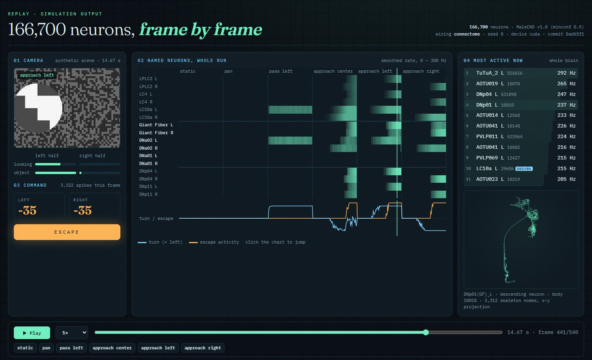

<div align="center">


# FlyBrain Robot Bridge

**A camera-to-robot controller whose brain is a spiking simulation of all 166,700 neurons
of the MaleCNS fruit-fly connectome.**


[](https://github.com/Frankweb33/flybrain-robot-bridge/actions/workflows/test.yml)
[](LICENSE)


[Status](#status) · [Demo](#demo) · [How it works](#how-it-works) · [Run it](#run-it) · [Validation](docs/VALIDATION.md) · [Limits](#limits)

</div>

Camera motion is turned into spikes in the fly's own looming and object-detecting visual
neurons. The whole connectome, 25.6 million connections from the public
[MaleCNS v1.0](https://male-cns.janelia.org/) release, carries that activity to real
descending neurons: the Giant Fiber commands escape, DNa01 and DNa02 steer. Their firing
rates become left and right motor commands for a walking robot.

## Status

Every ✅ row can be checked on your own machine with the command or file listed.

| | What | How to check |
|---|---|---|
| ✅ | Loads the full MaleCNS v1.0 connectome: 166,700 neurons, 25,582,938 connections, 124,177,617 synapses, from SHA-256-pinned public files | `python -m flybrain_robot.connectome.build compile` |
| ✅ | Simulates every neuron with the leaky integrate-and-fire model of [Shiu et al. 2024](https://www.nature.com/articles/s41586-024-07763-9) | `src/flybrain_robot/brain/lif.py` |
| ✅ | Simulation kernel reproduces Brian2, the reference simulator, **spike for spike** | `pytest tests/test_lif_reference.py` |
| ✅ | The GPU kernel reproduces the CPU kernel **bit for bit** on one machine, including 540 frames of motor commands in the closed loop (across machines the per-step constants come from the platform's `exp`, which is not correctly rounded) | [VALIDATION.md §2b](docs/VALIDATION.md#2b-cpu-and-gpu-kernels-agree-exactly), `pytest tests/test_lif_cuda.py` |
| ✅ | Faster than real time on a desktop GPU: closed loop 1.7–6.5×, strongest looming stimulus 1.7× (RTX 3050, median of three timings); on the CPU 0.2–0.3× under strong input | [VALIDATION.md §5, §6](docs/VALIDATION.md#6-speed) |
| ✅ | Looming on one side drives the Giant Fiber; a moving object drives same-side DNa02 steering; shuffled wiring does not | [VALIDATION.md §4](docs/VALIDATION.md#4-visual-pathways-in-the-whole-brain-model) |
| ✅ | Closed loop on synthetic camera scenes: turns toward a passing object, escapes from approaching ones, ignores camera pans; all behaviour disappears with shuffled wiring | [VALIDATION.md §5](docs/VALIDATION.md#5-closed-loop-synthetic-camera-scenes--connectome--motor-commands) |
| ✅ | Every frame of a run can be replayed in the browser, down to the most active single neurons and their neuPrint skeletons | [web/replay.html](web/replay.html), see [Replay](#demo) |
| ✅ | ESP32 receiver firmware (servos, IMU telemetry, arming, watchdog) compiles | CI `firmware` job, [firmware/](firmware/atom_matrix/README.md) |
| ✅ | Johnston's organ, the fly's gravity sensor, drives mirror-image descending responses that vanish on shuffled wiring (21 pairs, pre-registered) | [VALIDATION.md §4c](docs/VALIDATION.md#4c-body-sense-johnstons-organ-pre-registered) |
| ⬜ | Body feedback in the loop: robot tilt reaches hundreds of descending cells and pitch leaves motor commands unchanged, but a 20° roll onto the left side reaches the escape threshold in 3 of 5 brain seeds (a right roll turns the robot in 1 of 5), so `body_feedback` is experimental and off by default | [VALIDATION.md §4d](docs/VALIDATION.md#4d-tilted-robot-in-the-closed-loop-pre-registered) |
| ⬜ | Vision from pixels through the fly's own motion circuits: driving the 5,826 photoreceptors reaches the motion detectors T4 and T5, whose ON/OFF polarity then follows from the transmitter signs (in the dark T5a 7.1 → 9.2 Hz, T4a 9.6 → 6.5 Hz, though Mi1 comes out the wrong way), but two pre-registered checks find **no direction selectivity** (index 0.00 with one synaptic time constant, −0.015 with the reported slow inputs, against 0.001 on shuffled wiring), so the robot uses optical-flow features (`vision: eye` and `vision: retina` are experimental) | [VALIDATION.md §5c](docs/VALIDATION.md#5c-motion-detectors-from-pixels-pre-registered) |
| ⬜ | Reproduce the published sugar → MN9 feeding circuit ([Shiu et al.](https://www.nature.com/articles/s41586-024-07763-9)): sugar neurons engage G2N-1, Zorro, Phantom, Roundup and Fudog and drive MN9 to 30 Hz (0 Hz with shuffled wiring), but taste-peg neurons also reach MN9 through Roundup, so the pre-registered specificity check fails | [VALIDATION.md §4b](docs/VALIDATION.md#4b-published-feeding-circuit-pre-registered) |
| ⬜ | Run on a physical Strandbeest robot | [HARDWARE.md](docs/HARDWARE.md): not done yet, no recording in this repository |
| ⬜ | Biologically accurate fly behaviour | out of scope for an LIF approximation, see [Limits](#limits) |

## Demo


*Rendered from an actual run of the 166,700-neuron model on the synthetic test scenes
(`examples/render_connectome_demo.py`). A visualization of simulation output, not a
robot recording.*


The control keeps every neuron, its transmitter, its outgoing synapse counts and its
number of incoming and outgoing connections, and randomly permutes which neuron each
synapse reaches. With the same
camera input, the Giant Fiber peaks at 190–260 Hz on the real wiring and at most 17 Hz on
shuffled wiring, and steering disappears.

**Replay any frame yourself.** `web/replay.html` plays back an exported run: the camera
frame, the rates of the named neurons over the whole tour, the motor command, and the 30
most active of all 166,700 neurons at that moment. Click one to draw its reconstructed
skeleton from [neuPrint](https://neuprint.janelia.org). The included run
(`web/runs/tour.json`) was exported from the full model; export your own, for example with
shuffled wiring, and compare.

```bash
python -m flybrain_robot.replay --data data/malecns-v1.0 --out web/runs/tour.json   # optional, 540 frames
python -m http.server --directory web 8000   # then open http://localhost:8000/replay.html
```



## How it works


1. **Vision** (`vision.py`): optical flow per image half → *looming* (expansion inside a
   moving region) and *object* (motion relative to the background). Pans and sideways
   motion do not register as looming.
2. **Sensory interface**: looming drives LPLC2 and LC4 neurons, object motion drives LC10a
   neurons of the matching optic lobe, with Poisson spikes at up to 150 Hz. Optionally,
   robot tilt drives Johnston's organ neurons (experimental, off by default).
3. **Connectome** (`brain/lif.py`, `brain/lif_cuda.py`, `brain/malecns.py`): all 166,700
   neurons at 0.1 ms steps, on the GPU when one is available. Nothing between the driven
   neurons and the read-out is hand-wired.
4. **Motor read-out**: smoothed Giant Fiber (DNp01) rate → escape (reverse); DNa01 + DNa02
   left minus right → turn; a constant forward cruise.
5. **Robot link**: validated JSON over UDP to an ESP32 receiver with its own watchdog.

The two interfaces in steps 2 and 4 are hand-chosen and documented with their evidence in
[MALECNS_INTEGRATION.md](docs/MALECNS_INTEGRATION.md). Two model settings differ from the
reference and are explained there with the measurements behind them: the per-synapse weight
is rescaled for MaleCNS's higher synapse density, and neuromodulators have no fast synaptic
effect. With the reference settings, one looming stimulus leaves the brain firing about a
million spikes per second after the input stops.

## Run it

Requires Python 3.11+.

```bash
git clone https://github.com/Frankweb33/flybrain-robot-bridge.git
cd flybrain-robot-bridge
python3.11 -m venv .venv && source .venv/bin/activate
pip install -e ".[dev,connectome]"
pip install -e ".[gpu]"   # optional, NVIDIA GPU with a CUDA 13 driver
```

**30-second demo, no download** (the small hand-made mock backend, not a connectome):

```bash
python -m flybrain_robot.main --backend mock --synthetic --dry-run --steps 90
```

**The connectome** (1.1 GB download; the compile step prints its own seconds and peak
memory, 21 s and 4.3 GB here, and records both in the manifest and the report):

```bash
python -m flybrain_robot.connectome.build download --data data/malecns-v1.0
python -m flybrain_robot.connectome.build compile  --data data/malecns-v1.0
python -m flybrain_robot.main --backend malecns --synthetic --scene approach_left --dry-run --steps 90
python -m flybrain_robot.main --backend malecns --synthetic --scene approach_left --wiring shuffled --dry-run --steps 90
```

Each status line shows camera features, Giant Fiber and DNa02 rates, the motor command and
how fast the brain runs relative to real time. `--device cpu` or `--device cuda` picks the
simulator; both give identical results. Other sources: `--camera 0`,
`--video path.mp4`, or `--scene` with `static`, `pan`, `pass_left`, `approach_center`,
`approach_right`, `tour`.

**In the browser, without installing anything:** open
[examples/colab_quickstart.ipynb](https://colab.research.google.com/github/Frankweb33/flybrain-robot-bridge/blob/main/examples/colab_quickstart.ipynb)
in Google Colab. It downloads and compiles the connectome and compares the real and the
shuffled wiring on two scenes.

**Reproduce every number in the validation report** (adds Brian2; 6–10 minutes with a GPU):

```bash
pip install -e ".[reference]"
python -m flybrain_robot.validation --data data/malecns-v1.0
```

The `Dockerfile` builds a CPU image for the same commands (see the comments at its top), and
the `validate` workflow re-runs the validation on a GitHub runner every week.

## Connecting a robot

```bash
cp config.example.yaml config.yaml   # robot_ip, ports, max_speed, backend: malecns
python -m flybrain_robot.main --camera 0 --config config.yaml --send
```

Flash [firmware/atom_matrix](firmware/atom_matrix/README.md) and follow the bring-up
checklist in [HARDWARE.md](docs/HARDWARE.md). Motors stay at neutral until the firmware is
marked calibrated **and** armed with the button. The PC sends stop commands when telemetry
is older than 500 ms; the receiver stops on its own after 500 ms without a command. UDP is
unauthenticated: use an isolated network. Add `--record runs` to save the camera video,
a per-frame log of features, neuron rates, IMU and commands, and the commit and settings
of the run ([Recording a run](docs/HARDWARE.md#recording-a-run)).

## Limits

- **Not yet tested on hardware.** The firmware compiles; flashing, calibration and a
  recorded run on a robot are the next milestone.
- **A model, not a fly.** Leaky integrate-and-fire neurons with weights proportional to
  synapse counts and EM-predicted transmitters. No graded potentials, gap junctions,
  neuromodulation, plasticity or body. Published LIF models of the fly brain reproduce some
  sensorimotor circuits, not full behaviour.
- **The rates are model quantities, not measurements.** The model's Giant Fiber fires 127
  spikes during one approach where the fly fires about one action potential, and this
  report prints firing rates for cells that do not spike in the fly at all — the lamina,
  the medulla interneurons, CT1, HS and VS cells, T4 and T5. Where the model can be
  compared with recordings, the comparison is in [VALIDATION.md §5f](docs/VALIDATION.md).
- **Most of the brain is along for the ride.** In an approach scene 2,529 of the 166,700
  neurons fire at all, and a 2,011-neuron subnetwork — the driven cells, the read-out cells
  and the neurons on two-synapse paths between them — reproduces the motor commands to
  within a few percent ([§5d](docs/VALIDATION.md)). The whole connectome is simulated; it
  is not what produces the behaviour here.
- **No senses but one, and no body.** 17,901 sensory neurons are simulated at zero: no
  smell, taste, mechanosensation, wind or leg load, and in the default mode no
  photoreceptors either. 708 nerve-cord motor neurons are simulated and ignored, because
  there are no muscles. Without input the model is completely silent (0 spikes per second),
  which a fly brain never is.
- **Hand-made interfaces.** Camera features are optical-flow heuristics injected into whole
  neuron populations with hemifield resolution; the fly's own photoreceptors and motion
  circuits are bypassed by default. Driving the photoreceptors instead reaches T4 and T5,
  whose ON/OFF polarity mostly follows, but gives no direction selectivity (§5c). The
  read-out constants (60 Hz for a full turn, 60 Hz for full escape) are fitted to the
  robot, and mapping the Giant Fiber onto a reverse is an engineering choice: in the fly it
  commands a takeoff, and backward walking is commanded by MDN. Forward cruise is a
  controller constant.
- **Speed.** The brain advances one camera frame (33 ms) per step. A desktop GPU keeps up
  with every synthetic scene; on a CPU alone, strong visual input takes about five times longer
  than real time, so a live robot gets fewer commands per second.
- **Synthetic scenes only.** Real webcams, lighting and motion blur are untested.

## Roadmap

- [x] Whole-MaleCNS LIF backend with Brian2-verified kernel
- [x] Looming, object and steering pathways validated against shuffled controls
- [x] Receiver firmware that compiles for M5Stack Atom Matrix
- [x] GPU kernel, bit-identical to the CPU kernel, faster than real time
- [x] Body sense through Johnston's organ (experimental)
- [x] Browser replay of exported runs, down to single neurons
- [x] Run recording (video, per-frame log, metadata) for physical runs
- [ ] Reproduce a published circuit result with a pre-registered check (sugar → MN9 attempted, fails specificity)
- [ ] Bench test of firmware: calibration, watchdog, Wi-Fi loss
- [ ] Recorded closed-loop run of the physical robot
- [ ] Real-camera evaluation of the looming and object encoders
- [x] Retinotopic input that reaches the motion detectors (photoreceptor drive reaches T4 and T5)
- [ ] Direction-selective motion detectors from pixels (measured index 0.00; needs input-specific synaptic kinetics, not only wiring)

## Sources and attribution

- **Connectome:** MaleCNS v1.0, HHMI Janelia FlyEM, Google Research, MRC LMB and
  collaborators, [male-cns.janelia.org](https://male-cns.janelia.org/), licensed CC BY 4.0.
  Not bundled; downloaded from the original source. The authors do not endorse this project.
- **Neuron model:** Shiu, P. K. et al. *A Drosophila computational brain model reveals
  sensorimotor processing.* Nature 634, 210–219 (2024).
  [Code](https://github.com/philshiu/Drosophila_brain_model) (MIT). Its FlyWire
  connectivity file was used only to compute the synapses-per-neuron figure for weight
  rescaling; no FlyWire data is used or distributed here.
- **Cell-type function:** Klapoetke et al. 2017 (LPLC2), von Reyn et al. 2014 and 2017
  (Giant Fiber, LC4), Ribeiro et al. 2018 (LC10a), Rayshubskiy et al. 2020 (DNa01/DNa02).
- Related community projects: [nftechie/doomfly](https://github.com/nftechie/doomfly),
  [ornata/fly](https://github.com/ornata/fly),
  [eonsystemspbc/fly-brain](https://github.com/eonsystemspbc/fly-brain),
  [philshiu/Drosophila_brain_model](https://github.com/philshiu/Drosophila_brain_model),
  [DenisSergeevitch/desktop-fly](https://github.com/DenisSergeevitch/desktop-fly).

## Development

```bash
pip install -e ".[dev,connectome,reference,demo]"
ruff check .
pytest -q
```

See [CONTRIBUTING.md](CONTRIBUTING.md). Changes to the brain path must regenerate
`docs/VALIDATION.md`.

## License

[MIT](LICENSE) for the code. Datasets and dependencies keep their own licenses.
