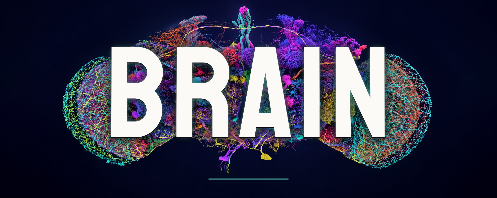
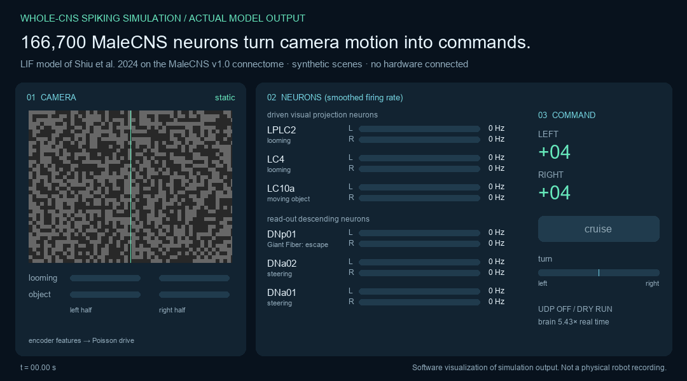
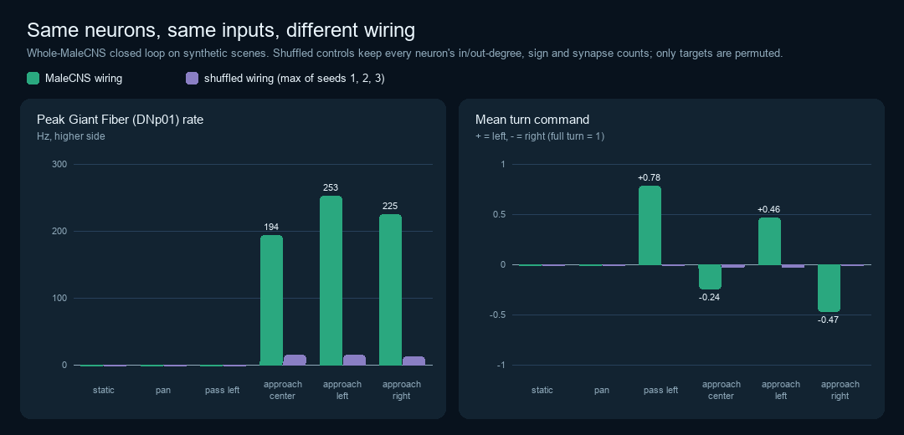
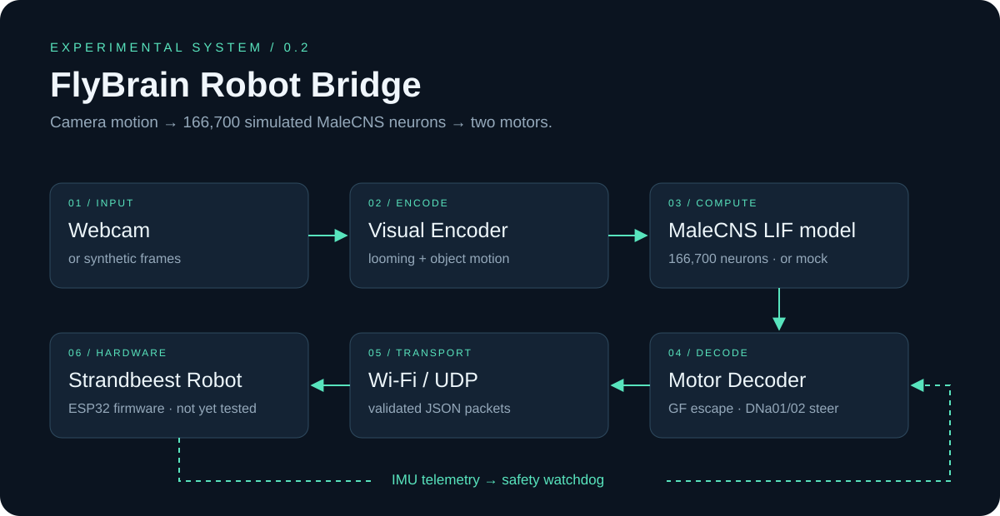

<div align="center">



# FlyBrain Robot Bridge

**A camera-to-robot controller whose brain is a spiking simulation of all 166,700 neurons
of the MaleCNS fruit-fly connectome.**


[](https://github.com/Frankweb33/flybrain-robot-bridge/actions/workflows/test.yml)
[](LICENSE)


[Status](#status) · [Demo](#demo) · [How it works](#how-it-works) · [Run it](#run-it) · [Validation](docs/VALIDATION.md) · [Limits](#limits)

</div>

Camera motion is turned into spikes in the fly's own looming and object-detecting visual
neurons. The whole connectome, 25.6 million connections from the public
[MaleCNS v1.0](https://male-cns.janelia.org/) release, carries that activity to real
descending neurons: the Giant Fiber commands escape, DNa01 and DNa02 steer. Their firing
rates become left and right motor commands for a walking robot.

## Status

Every ✅ row can be checked on your own machine with the command or file listed.

| | What | How to check |
|---|---|---|
| ✅ | Loads the full MaleCNS v1.0 connectome: 166,700 neurons, 25,582,938 connections, 124,177,617 synapses, from SHA-256-pinned public files | `python -m flybrain_robot.connectome.build compile` |
| ✅ | Simulates every neuron with the leaky integrate-and-fire model of [Shiu et al. 2024](https://www.nature.com/articles/s41586-024-07763-9) | `src/flybrain_robot/brain/lif.py` |
| ✅ | Simulation kernel reproduces Brian2, the reference simulator, **spike for spike** | `pytest tests/test_lif_reference.py` |
| ✅ | Looming on one side drives the Giant Fiber; a moving object drives same-side DNa02 steering; shuffled wiring does not | [VALIDATION.md §4](docs/VALIDATION.md#4-visual-pathways-in-the-whole-brain-model) |
| ✅ | Closed loop on synthetic camera scenes: turns toward a passing object, escapes from approaching ones, ignores camera pans; all behaviour disappears with shuffled wiring | [VALIDATION.md §5](docs/VALIDATION.md#5-closed-loop-synthetic-camera-scenes--connectome--motor-commands) |
| ✅ | ESP32 receiver firmware (servos, IMU telemetry, arming, watchdog) compiles | CI `firmware` job, [firmware/](firmware/atom_matrix/README.md) |
| ⬜ | Run on a physical Strandbeest robot | [HARDWARE.md](docs/HARDWARE.md): not done yet, no recording in this repository |
| ⬜ | Real-time speed under strong visual input | 0.24–0.58× real time on a desktop CPU ([§6](docs/VALIDATION.md#6-speed)) |
| ⬜ | Biologically accurate fly behaviour | out of scope for an LIF approximation, see [Limits](#limits) |

## Demo



*Rendered from an actual run of the 166,700-neuron model on the synthetic test scenes
(`examples/render_connectome_demo.py`). A visualization of simulation output, not a
robot recording.*



The control keeps every neuron, its transmitter, its synapse counts and its number of
inputs and outputs, and randomly permutes which neuron each synapse reaches. With the same
camera input, the Giant Fiber peaks at 194–253 Hz on the real wiring and at most 15 Hz on
shuffled wiring, and steering disappears.

## How it works



1. **Vision** (`vision.py`): optical flow per image half → *looming* (expansion inside a
   moving region) and *object* (motion relative to the background). Pans and sideways
   motion do not register as looming.
2. **Sensory interface**: looming drives LPLC2 and LC4 neurons, object motion drives LC10a
   neurons of the matching optic lobe, with Poisson spikes at up to 150 Hz.
3. **Connectome** (`brain/lif.py`, `brain/malecns.py`): all 166,700 neurons at 0.1 ms
   steps. Nothing between the driven neurons and the read-out is hand-wired.
4. **Motor read-out**: smoothed Giant Fiber (DNp01) rate → escape (reverse); DNa01 + DNa02
   left minus right → turn; a constant forward cruise.
5. **Robot link**: validated JSON over UDP to an ESP32 receiver with its own watchdog.

The two interfaces in steps 2 and 4 are hand-chosen and documented with their evidence in
[MALECNS_INTEGRATION.md](docs/MALECNS_INTEGRATION.md). Two model settings differ from the
reference and are explained there with the measurements behind them: the per-synapse weight
is rescaled for MaleCNS's higher synapse density, and neuromodulators have no fast synaptic
effect. With the reference settings, one looming stimulus leaves the brain firing about a
million spikes per second after the input stops.

## Run it

Requires Python 3.11+.

```bash
git clone https://github.com/Frankweb33/flybrain-robot-bridge.git
cd flybrain-robot-bridge
python3.11 -m venv .venv && source .venv/bin/activate
pip install -e ".[dev,connectome]"
```

**30-second demo, no download** (the small hand-made mock backend, not a connectome):

```bash
python -m flybrain_robot.main --backend mock --synthetic --dry-run --steps 90
```

**The connectome** (1.1 GB download, about 40 s compile, 16 GB RAM is enough):

```bash
python -m flybrain_robot.connectome.build download --data data/malecns-v1.0
python -m flybrain_robot.connectome.build compile  --data data/malecns-v1.0
python -m flybrain_robot.main --backend malecns --synthetic --scene approach_left --dry-run --steps 90
python -m flybrain_robot.main --backend malecns --synthetic --scene approach_left --wiring shuffled --dry-run --steps 90
```

Each status line shows camera features, Giant Fiber and DNa02 rates, the motor command and
how fast the brain runs relative to real time. Other sources: `--camera 0`,
`--video path.mp4`, or `--scene` with `static`, `pan`, `pass_left`, `approach_center`,
`approach_right`, `tour`.

**Reproduce every number in the validation report** (adds Brian2; about 5 minutes):

```bash
pip install -e ".[reference]"
python -m flybrain_robot.validation --data data/malecns-v1.0
```

## Connecting a robot

```bash
cp config.example.yaml config.yaml   # robot_ip, ports, max_speed, backend: malecns
python -m flybrain_robot.main --camera 0 --config config.yaml --send
```

Flash [firmware/atom_matrix](firmware/atom_matrix/README.md) and follow the bring-up
checklist in [HARDWARE.md](docs/HARDWARE.md). Motors stay at neutral until the firmware is
marked calibrated **and** armed with the button. The PC sends stop commands when telemetry
is older than 500 ms; the receiver stops on its own after 500 ms without a command. UDP is
unauthenticated: use an isolated network.

## Limits

- **Not yet tested on hardware.** The firmware compiles; flashing, calibration and a
  recorded run on a robot are the next milestone.
- **A model, not a fly.** Leaky integrate-and-fire neurons with weights proportional to
  synapse counts and EM-predicted transmitters. No graded potentials, gap junctions,
  neuromodulation, plasticity or body. Published LIF models of the fly brain reproduce some
  sensorimotor circuits, not full behaviour.
- **Hand-made interfaces.** Camera features are optical-flow heuristics injected into whole
  neuron populations with hemifield resolution; the fly's own photoreceptors and motion
  circuits are bypassed. Forward cruise is a controller constant.
- **Speed.** The brain advances one camera frame (33 ms) per step; with strong visual input
  a desktop CPU needs longer than that, so a live robot gets fewer commands per second.
- **Synthetic scenes only.** Real webcams, lighting and motion blur are untested.

## Roadmap

- [x] Whole-MaleCNS LIF backend with Brian2-verified kernel
- [x] Looming, object and steering pathways validated against shuffled controls
- [x] Receiver firmware that compiles for M5Stack Atom Matrix
- [ ] Bench test of firmware: calibration, watchdog, Wi-Fi loss
- [ ] Recorded closed-loop run of the physical robot
- [ ] Real-camera evaluation of the looming and object encoders
- [ ] GPU kernel for real-time whole-brain simulation under strong input
- [ ] Retinotopic input instead of whole-population drive

## Sources and attribution

- **Connectome:** MaleCNS v1.0, HHMI Janelia FlyEM, Google Research, MRC LMB and
  collaborators, [male-cns.janelia.org](https://male-cns.janelia.org/), licensed CC BY 4.0.
  Not bundled; downloaded from the original source. The authors do not endorse this project.
- **Neuron model:** Shiu, P. K. et al. *A Drosophila computational brain model reveals
  sensorimotor processing.* Nature 634, 210–219 (2024).
  [Code](https://github.com/philshiu/Drosophila_brain_model) (MIT). Its FlyWire
  connectivity file was used only to compute the synapses-per-neuron figure for weight
  rescaling; no FlyWire data is used or distributed here.
- **Cell-type function:** Klapoetke et al. 2017 (LPLC2), von Reyn et al. 2014 and 2017
  (Giant Fiber, LC4), Ribeiro et al. 2018 (LC10a), Rayshubskiy et al. 2020 (DNa01/DNa02).
- Related community projects: [nftechie/doomfly](https://github.com/nftechie/doomfly),
  [ornata/fly](https://github.com/ornata/fly),
  [eonsystemspbc/fly-brain](https://github.com/eonsystemspbc/fly-brain),
  [philshiu/Drosophila_brain_model](https://github.com/philshiu/Drosophila_brain_model),
  [DenisSergeevitch/desktop-fly](https://github.com/DenisSergeevitch/desktop-fly).

## Development

```bash
pip install -e ".[dev,connectome,reference,demo]"
ruff check .
pytest -q
```

See [CONTRIBUTING.md](CONTRIBUTING.md). Changes to the brain path must regenerate
`docs/VALIDATION.md`.

## License

[MIT](LICENSE) for the code. Datasets and dependencies keep their own licenses.
